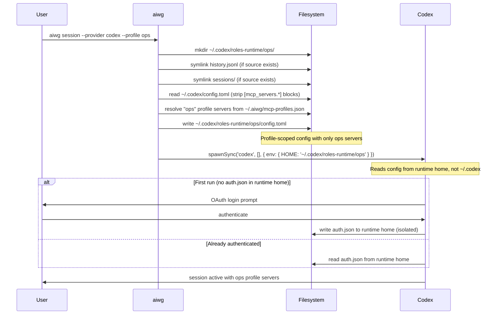

# Codex Per-Profile Runtime Homes

Codex has no native per-session config flag (unlike `claude --mcp-config`). AIWG
implements OAuth isolation per MCP profile by giving each profile its own runtime
home directory. Codex is launched with `HOME=<runtime-home>` so all config reads,
auth token writes, and OAuth flows are scoped to that profile.

AIWG preserves the parent configuration directory through `AIWG_CONFIG` before
changing `HOME`. Commands inside the profile therefore retain the operator's
installation identity and development channel. An explicit `AIWG_CONFIG` takes
precedence; otherwise AIWG resolves the parent's existing `~/.aiwg` or
`~/.config/aiwg` directory.

This mirrors the sysops `codex-role.sh` pattern from `roctinam/sysops`.

## How It Works

```
~/.codex/                          ← global Codex home (shared)
├── history.jsonl                  ← symlinked into each runtime home
├── sessions/                      ← symlinked into each runtime home
└── roles-runtime/                 ← runtime homes live here
    ├── dev/                       ← runtime home for "dev" profile
    │   ├── config.toml            ← profile-scoped MCP server config
    │   ├── auth.json              ← OAuth tokens (isolated per profile)
    │   ├── history.jsonl  →       ← symlink to ~/.codex/history.jsonl
    │   └── sessions/      →       ← symlink to ~/.codex/sessions/
    └── ops/                       ← runtime home for "ops" profile
        ├── config.toml
        ├── auth.json
        ├── history.jsonl  →
        └── sessions/      →
```

**Isolated per profile:** `auth.json`, `.credentials`, `config.toml`  
**Shared across profiles:** `history.jsonl`, `sessions/`

## Session Flow



## Using Profile Sessions

```bash
# First run: triggers OAuth for this profile
aiwg session --provider codex --profile ops

# Subsequent runs: uses cached auth from the runtime home
aiwg session --provider codex --profile ops

# Different profile — separate auth, separate config
aiwg session --provider codex --profile dev
```

Each profile authenticates independently. Logging out of one profile does not affect
other profiles.

## Explicit Login

Run OAuth login for a profile without starting a full session:

```bash
aiwg mcp profile login ops
```

This calls `codex login` with `HOME`/`CODEX_HOME` set to the profile runtime home.
Useful for pre-authenticating profiles before starting a session. With a terminal
attached, this runs the normal interactive OAuth flow — the same one a first
`aiwg session --provider codex --profile ops` would trigger.

**Running headless (#3062):** without a terminal, pass exactly one of three flags
naming where the API key comes from — see
[Supplying credentials safely](#supplying-credentials-safely) for which one to
prefer and why:

```bash
# Most preferred: piped from a secret manager, never in an environment or on argv
vault read -field=key secret/openai | aiwg mcp profile login ops --api-key-stdin

# Preferred: a private file only you can read
aiwg mcp profile login ops --api-key-file ~/.config/aiwg/openai-key

# Least preferred: a named environment variable (go/no-go review, blocker 1C)
aiwg mcp profile login ops --api-key-env OPENAI_API_KEY
```

In every case the key reaches `codex login --with-api-key` over stdin only — it
never appears on argv, in logs, or in any error message. `--api-key-stdin` refuses
if stdin is a terminal (run the plain interactive login instead) or empty.
`--api-key-file <path>` refuses unless the file is a regular file, not a symlink,
with exactly one hard link, owned by you, and not readable or writable by group or
other (`chmod 600`) — never printing the path's contents. `--api-key-env` reads the
named variable and, as of the go/no-go review's blocker 1, is also kept out of
*this process's own* child environment and out of `NODE_DEBUG=child_process`
diagnostics, including a background subprocess this CLI itself might otherwise
start (see [Supplying credentials safely](#supplying-credentials-safely)); it
remains the least preferred of the three because the variable is still visible to
every *other* child process the invoking shell starts. Only one of the three may be
given — more than one is a usage error naming the flags given. If the named
variable (or file) is unset/missing, the error names it (never a value, since there
was none). Without a terminal and without any of the three, the command errors
naming all three flags instead of hanging waiting for input nobody can supply.

This command requires the built CLI (`npm run build:cli` in a source checkout, or
an installed `aiwg`) — if the compiled module is missing it reports that directly
instead of attempting to load TypeScript source and failing deep inside an unrelated
import (#3062 second review, finding 3).

## Running A Profile Session Headless

Without a terminal, launching a codex session with a profile and no
`--prompt`/`--prompt-file` refuses instead of hanging waiting for a terminal (same
rule as the plain, non-profile launch). Pass `--prompt`/`--prompt-file` to run the
profile's runtime home headless instead — the prompt travels on stdin via `codex
exec -` (see [the headless-running reference](../getting-started/worker-dispatch.md)
and `docs/providers/codex-direct.md` for the evidence), never on argv.

## Supplying Credentials Safely

Go/no-go review, blocker 1. When a headless command needs a secret (an API key, a
token), prefer these methods in this order — most preferred first — because each
one is visible to a progressively wider audience on the machine running it:

1. **Interactive login at a terminal.** Nothing is ever supplied on the command
   line or in the environment at all; `codex` prompts you directly.

   ```bash
   aiwg mcp profile login ops
   ```

2. **Piped from a secret manager, over this process's own stdin.** The secret
   exists only for the lifetime of the pipe; it is never written to an
   environment variable or a file, and never appears on any command line.

   ```bash
   vault read -field=key secret/openai | aiwg mcp profile login ops --api-key-stdin
   ```

3. **A private file.** The secret sits on disk, but only you (and anything
   running as you) can read it — enforced, not just documented: a mode-600,
   non-symlink, single-hard-link regular file you own.

   ```bash
   aiwg mcp profile login ops --api-key-file ~/.config/aiwg/openai-key
   ```

4. **A named environment variable.** The least preferred of the four: an
   environment variable is visible to *every other child process the invoking
   shell starts* for the lifetime of that shell, not just to the one command you
   meant it for.

   ```bash
   export OPENAI_API_KEY=sk-...
   aiwg mcp profile login ops --api-key-env OPENAI_API_KEY
   ```

Two things make option 4 riskier than it looks, and apply to *any* secret-bearing
environment variable, not just this command:

- **A command-line argument is visible in a process listing** (`ps`, `/proc`,
  task managers) to anyone who can see your process list — never pass a secret
  value itself as an argument; a variable *name* is fine.
- **Debug logging of child processes prints environments.** Setting
  `NODE_DEBUG=child_process` (or an equivalent diagnostic in another language's
  child-process library) makes that process print every child's full spawn
  options — including its environment — to your own terminal. This is exactly
  how the go/no-go review found blocker 1: a background subprocess this CLI
  itself starts on every invocation (the update-notifier bootstrap,
  `src/update/notifier.mjs`) used to inherit the whole parent environment,
  which under `NODE_DEBUG=child_process` printed whatever `--api-key-env` named.
  Fixed two ways, both durable regardless of which command runs: `bin/aiwg.mjs`
  now never starts that bootstrap subprocess at all for a command it recognizes
  as credential-handling (today: `aiwg mcp profile login`,
  `aiwg decision setup jev`), and the bootstrap subprocess's own environment is
  now an explicit allow-list (`notifierChildEnv()`) instead of a full copy of
  the parent's, so a secret this CLI does not yet know to name is still never
  copied into it, for *any* command.

## Shared State Policy

The `SharedStatePolicy` controls which files are symlinked (shared) vs isolated per
profile. The default policy:

| Item | Behavior | Reason |
|------|----------|--------|
| `history.jsonl` | Symlinked (shared) | Operator history is cross-profile |
| `sessions/` | Symlinked (shared) | Session index is cross-profile |
| `auth.json` | Isolated | OAuth tokens are profile-scoped |
| `.credentials` | Isolated | Credentials are profile-scoped |
| `config.toml` | Isolated | MCP server config is profile-scoped |

Symlinks are created only when the source exists in `~/.codex/`. If the source does
not exist, the symlink is skipped silently (the runtime home still works).

## config.toml Generation

When setting up a runtime home, AIWG:

1. Reads `~/.codex/config.toml` (if it exists)
2. Strips all `[mcp_servers.*]` sections
3. Appends profile-scoped `[mcp_servers.*]` blocks for each server in the profile

Each server block follows the Codex TOML format:

```toml
[mcp_servers.git-gitea]
command = "npx"
args = ["-y", "@gitea/mcp-server"]
env.GITEA_TOKEN = "..."
startup_timeout_sec = 10.0
tool_timeout_sec = 60.0
```

Non-MCP settings from the global config (model preferences, theme, keybindings) are
preserved.

## Runtime Home Management

```bash
# List all runtime homes
aiwg mcp profile runtimes list

# Show details for a profile
aiwg mcp profile runtimes show ops

# Remove a runtime home (deletes auth tokens)
aiwg mcp profile runtimes remove ops

# Detect orphaned runtime homes (profile deleted but runtime home remains)
aiwg mcp profile runtimes orphans
```

## Troubleshooting

### "Runtime home does not exist"

```
Error: Runtime home for profile "ops" does not exist.
Run "aiwg mcp profile add ops" or "aiwg session --provider codex --profile ops" to create it.
```

Run `aiwg session --provider codex --profile ops` once to initialize the runtime home.

### Auth tokens not persisting across sessions

Verify the runtime home was created with the correct path:

```bash
ls ~/.codex/roles-runtime/ops/auth.json
```

If missing, the OAuth flow did not complete. Re-run `aiwg session --provider codex --profile ops`.

### MCP servers not appearing in Codex

Check the generated config:

```bash
cat ~/.codex/roles-runtime/ops/config.toml
```

If empty or missing `[mcp_servers.*]` blocks, the profile may have no servers resolved.
Run `aiwg mcp profile show ops` to verify the server list.

### Cross-device symlink errors

On systems where `~/.codex/` is on a different filesystem, symlinks may fail with
`EXDEV`. AIWG suppresses this error and continues — the runtime home still works,
but history and sessions will not be shared across profiles.

## Further Reading

- [MCP Profiles](./profiles.md) — Profile registry, CRUD, and provider overrides
- [CLI Reference: mcp profile](https://github.com/jmagly/aiwg/blob/main/docs/cli/reference.md#mcp-profile) — Full command reference
- [CLI Reference: session](https://github.com/jmagly/aiwg/blob/main/docs/cli/reference.md#session) — Session launcher with profile support
